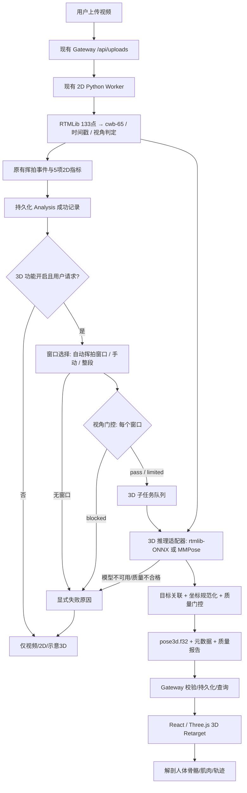
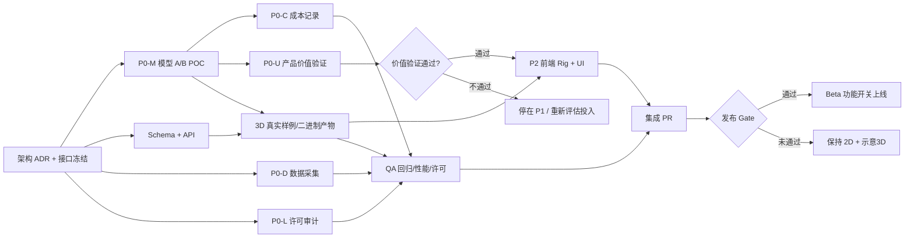

# Jojo Badminton Plan：AI 3D 动作重建升级方案（v1.1 优化版）

> **文档类型**：技术架构 / 开发实施 / Agent 任务与验收规范  
> **版本**：v1.1（设计稿，尚未实施；在 v1.0 基础上按评审意见修订）  
> **编写日期**：2026-11-15  
> **目标仓库**：https://github.com/zxt6991-source/jojo-badminton-plan  
> **代码基线**：`master`。v1.0 记录的 Git tree 为 `53952202cebc246edcacd1f183e2a283246e7bef`；v1.1 仅重新核对了仓库 README，**未重新核对源码**，实施前须由 Agent 重新审计（见附录 A）。  
> **核心原则**：保留已能运行的 2D 分析链路；将“二维骨架驱动的示意 3D”升级为“有来源、有置信度、有降级机制的 AI 三维姿态估计”；**先验证可行性与用户价值，再扩大工程投入**。

---

## 修订摘要（v1.0 → v1.1）

章节编号随新增内容重排，下表使用 v1.1 的新编号。

| # | 修订 | 原因 | 落点 |
|---|---|---|---|
| 1 | 新增 rtmlib（ONNX）路径，模型 POC 改为 A/B 对比 | rtmlib 模型库已列出 RTMW3D（133 点 3D），与现有 Worker 同栈；官方 H3WB 上 L 与 X 差异极小，选型应由部署成本和实测决定 | §0、§2 |
| 2 | 3D 默认只处理挥拍窗口 | 2D 链路已有击球事件；窗口推理可显著降低成本并缩小失败暴露面 | §3.2、§4 |
| 3 | 视角门控升为一级机制 | 单目深度可靠性随机位变化很大 | §3.3、§5.2、§6 |
| 4 | 数据采集提前到 P0 并行；增加无 3D 真值的验证指标；Gate C 改为可选 | 数据是关键路径；个人项目难以取得标定多视角或光学动捕 | §8、§11 |
| 5 | 许可审计成为发布硬门槛 | 3D 权重常基于学术数据集训练，商用条款须单独核对 | §2.3 |
| 6 | 新增产品价值验证（P0-U） | 3D 主要提升回放保真度，需验证用户价值后再做大规模前端重构 | §7、§11 |
| 7 | 新增部署与成本章节 | 产品目标为 App 与 Web，GPU 成本是上线前提 | §9 |
| 8 | 新增肌肉/解剖可视化的对外口径 | 防止产品文案把“示意着色”说成“真实发力” | §5.5 |
| 9 | 删除无依据的 MPJPE 示例目标 | 目标应由 P0 数据与产品需求共同确定 | §8.3 |
| 10 | 新增核查状态附录 | 区分“已核实 / 未核实 / 沿用 v1.0” | 附录 A |

---

## 0. 执行摘要：先定技术路线

**推荐路线：双轨并行、分步上线、先验证再投入。**

1. **保留原有 RTMLib/ONNX 的 2D 人体关键点推理**作为稳定基线；不要在第一阶段替换整个 Python Worker。
2. **3D 模型走 A/B POC，二选一进入集成**：
   - **路径 A（优先评估）**：rtmlib 中的 RTMW3D（ONNX）。与现有 Worker 同栈，不需要 mmcv/mmpose/torch 全家桶。
   - **路径 B（参照）**：MMPose 官方 RTMW3D-L。官方配置、权重与示例齐全，但依赖重，需独立环境。
   - 择优标准是**按视角分层的序数深度准确率、左右手交换率、耗时与成本、许可**，而不是“L 比 X 更准”（官方 H3WB 上 L 为 0.056、X 为 0.057，差异可忽略）。
   - 权重、依赖、输出坐标核实之前，不宣称已经集成。
3. **3D 默认只处理挥拍窗口**（击球事件前后），整段处理仅在用户显式请求且受上限约束时开放。
4. **视角门控是一级机制**：侧面/斜侧可展示，正面/后视受限，视角不确定则不展示 3D。
5. **保留现有 Three.js 解剖 GLB、蒙皮和 UI**，仅新增可靠的 3D 数据源与重定向求解器；支持 **AI 预测 3D / 原始视频或 2D 骨架 / 示意 3D** 三种明确标识的视图。
6. **MotionBERT 作为实验性对照方案**：复用现有 2D 关键点，通过时序模型 lifting 为 3D。它要求 17 点 Human3.6M 风格关键点映射，不应直接把 cwb-65 输入模型。
7. **暂不把 GPT/视觉语言模型放进低层动作重建链路**。大语言/多模态模型在后续阶段读取通过验证的运动指标与视频证据，生成可追溯的训练建议，不负责“编造”深度、角度和肌肉受力。
8. **P0 并行五条轨道**：模型 A/B POC、数据采集、许可审计、成本记录、产品价值验证。**P2 前端重构以 P0 的结论为前提**。

### 0.1 不可混淆的术语

| 名称 | 定义 | 本次项目是否提供 |
|---|---|---|
| 2D 姿态检测 | 图像上人体关节的 `(x,y,置信度)` | **已有** |
| 示意 3D | 2D 坐标添加人为 Z 偏移、驱动立体人物 | **已有**，不是真实三维重建 |
| 解剖模型肌肉着色 | 按解剖分组着色的示意，随姿态做动画 | **已有（示意）**，不代表激活或受力 |
| AI 单目 3D 姿态估计 | 模型从单个或连续视频帧预测人体相对三维结构 | **本次新增**；仍有深度歧义 |
| 世界坐标 3D 运动恢复 | 有相机/地面参考的全局轨迹、相机运动补偿 | **本次不承诺** |
| 肌肉激活 / 关节力矩 | 生物力学负荷估计，通常需要额外物理模型或传感器与验证 | **本次不做** |

**上线口径**：标注“AI 估计的相机相对 3D 姿态”，不得写“真实 3D 动捕”“厘米级重建”“精确转体角度”“肌肉真实发力”等未经实测验证的措辞。

---

## 1. 现有仓库审计与最小改造原则

### 1.1 已确认的实现

以下内容沿用 v1.0 的审计结论；其中与 README 描述一致的部分已核对，源码细节需在实施前重新审计。

| 文件 | 当前作用 | 升级策略 |
|---|---|---|
| `worker/main.py` | RTMLib `Wholebody` + ONNX Runtime，逐帧推理 133 点并转 65 点；视频和音频处理 | **保留**；新建 3D Worker，不破坏已有推理 |
| `worker/algorithms.py` | `to_cwb65`、One Euro 平滑、腕速度峰值/音频辅助击球识别 | **保留**；新 3D 数据不得修改已有指标语义 |
| `packages/schema/src/index.ts` | `SCHEMA_VERSION='0.1.0'`；`SkeletonRef.keypoints3dKey?` 预留但缺少独立 3D 坐标、单位与质量语义 | **扩展为 v0.2.0**，兼容旧记录 |
| `apps/gateway/src/app.ts` | Worker `spawn`、任务幂等、状态持久化、`timestamps.f32` / `keypoints.f32` 路径重写和校验 | **新增独立 3D 子任务**；不能只给 `keypoints3dKey` 填一个路径 |
| `apps/web/src/pose3d.ts` | 生成 `schematic-2d`，`Z` 固定左右展示间隔 | **保留旧函数作为降级**；新增真实模型输出的解析器 |
| `apps/web/src/anatomyRig.ts` | 解剖 GLB 运行时骨骼绑定；现有 `retarget` 实际只取 X/Y，令 Z 为 0 | **重点改造**：独立的 3D 关节重定向；保留旧算法 |
| `apps/web/src/Body3DViewer.tsx` | Three.js 渲染、相机、慢放、轨迹、肌肉/骨骼可见性 | **复用**；切换数据源与角度/轨迹展示语义 |
| `apps/web/src/MovementInsight.tsx` | 3D / 视频视图切换、动作阶段和文字提示 | **增加来源和可信度提示** |
| `apps/web/public/models/anatomy/body.glb` | 约 2.5MB 标准解剖网格，已有骨骼肌肉展示 | **复用**；保留原署名与许可证 |
| `scripts/evaluate.py` / `scripts/regression.py` | 当前主要是 2D/事件评测与回归 | **新增独立 3D 评测工具与报告** |

### 1.2 当前工程限制

- 当前成功任务只验证 `frameCount × 65 × 3` 的二维浮点数据；真实 3D 文件必须新增长度、布局、缺失值和坐标约定校验。
- 当前 `analysis.status` 是单一任务状态；3D 计算比 2D 重，**不能因为 3D 失败而抹掉已经成功的 2D 分析**。
- 当前 3D 解剖模型的 Z 坐标是示意值，实际 `retarget()` 使用 X/Y 求解。换上 3D 模型而不修改这个求解器，仍然不会得到可信的三维旋转。
- 当前演示数据是合成骨架，不可当作 AI 3D 验证数据；仓库也尚未具备可声称精度的真实 3D 标注集。
- 当前的视角、持拍侧、朝向与击球检测均为保守基线算法，**未经教练标注校准**（README 明确说明）。视角门控依赖它，因此门控本身也需要验证（见 §3.3）。
- 当前开发网关是本地单进程队列、文件存储；本次先兼容本地开发，不扩展为全新的云端微服务系统（上线所需的部署与成本问题见 §9）。

### 1.3 功能范围

**包含**：单人目标的 3D 姿态、挥拍窗口处理、视角门控、同帧同步、来源标注、三维角度的实验性显示、合理的姿态平滑与遮挡降级、模型适配层、精度与性能测试。

**不包含**：多人同步 3D 动捕、拍头/羽毛球精确轨迹、真实肌电/肌肉力学、无需校准的世界米制轨迹、自动判定“标准动作/错误动作”、实时移动端 3D 推理及付费教练 AI 服务。

---

## 2. 模型选型与许可（截至 2026-11-15 的核查结果）

### 2.1 选型表

| 方案 | 入口 / 输出 | 优点 | 主要问题 | 决策 |
|---|---|---|---|---|
| **RTMW3D（rtmlib-ONNX，路径 A）** | 视频 RGB → 133 点二维+三维姿态；rtmlib 模型库列有 RTMW3D，ONNX 清单为 x 档 | 与现有 RTMLib+ONNX Worker 同栈；无需 mmcv/mmpose/torch；CPU/GPU 后端可复用现有配置 | 具体类名、输入输出坐标约定、是否有 L 档 ONNX 均**未核实**；x 档计算量更大 | **POC A（优先评估）** |
| **RTMW3D-L（MMPose 官方，路径 B）** | 视频 RGB → 133 点二维+三维姿态 | 官方配置、权重与示例齐全；与现有 133/65 点方案易于索引对接 | 依赖重（torch/mmcv/mmpose/mmdet）；需独立环境；设备兼容与羽毛球场景效果待验证 | **POC B（参照）** |
| MotionBERT | 2D 时间序列 → 17 点三维姿态 | 可复用已有 RTMLib 2D 数据；显式利用前后帧 | 需 H36M 17 点映射与帧率处理；快速挥拍、遮挡和数据域差异需验证；权重与训练数据许可未核实 | **对照实验** |
| VideoPose3D | 2D 时间序列 → 17 点 3D | 架构简单、便于性能基准 | 官方仓库已归档；CC BY-NC（沿用 v1.0，未重新核实），不宜直接进商业产品 | **研究基线** |
| GVHMR / WHAM 等 | 单目视频 → 人体网格或全局运动 | 可进一步探索复杂动作/世界轨迹 | 集成成本高、依赖重；GVHMR 为非商业许可（沿用 v1.0，未重新核实）；网格与现有解剖 Rig 需适配 | **后续研究** |
| GPT / 通用 VLM | 视频或指标 → 文字分析 | 解释与用户交流、生成建议 | 不适合替代关键点检测与物理测量，不应充当几何真值 | **后续独立能力** |

**重要：不要将论文公开测试集分数直接当成羽毛球视频精度。**

- 官方 MMPose README 中，RTMW3D-L 与 X 在 H3WB 基准上的 MPJPE 分别为 `0.056` 与 `0.057`（按该基准的单位和协议解读），差异可忽略，不能据此认定 X 或 L 更准确。
- 第三方封装页面对 L 给出过不同的数字（例如 `0.045`），**不采信**；一律以官方出处为准，并以本项目实测为准。
- 开发时必须分别记录 2D/3D 模型、数据集、相机及推理配置。

### 2.2 推荐依赖策略

- **路径 A（rtmlib）**：即使同栈，也使用独立的 `requirements-pose3d.txt` 或独立虚拟环境，固定 rtmlib 与 onnxruntime 版本，避免 3D 依赖升级影响现有 2D Worker。
- **路径 B（MMPose）**：通过**独立虚拟环境或独立 Python 子进程**接入，避免破坏现有 `worker/requirements.txt` 中 RTMLib/ONNX 依赖。
- 先使用官方示例与已核实的权重跑通单帧，再尝试使用外部球员 bbox 和视频批处理。
- 不固定写死网上某个第三方封装的输出坐标变换；以本地对照验证出的实际 API 输出、原版模型脚本和元数据为准。
- 模型代码/权重/依赖包分别记录许可及 SHA-256；不要把“框架是 Apache-2.0”误当成所有权重、训练集或解剖素材都允许商业使用。
- `ALLOW_MODEL_DOWNLOAD` 等自动下载行为**默认关闭**，由开发环境显式配置；线上只加载已审批权重。
- 提供 A/B 对比脚本：同一视频、同一帧，输出两条路径的关键点次序、左右、z 符号约定与数值差异。

### 2.3 许可审计（发布硬门槛）

在任何商业发布之前，下表每一项都必须有书面结论，记录于 `docs/pose3d-license-review.md`。

| 组件 | 需要确认的问题 | 当前状态 |
|---|---|---|
| 推理代码（rtmlib、MMPose、MotionBERT） | 开源许可是否允许商用与闭源分发 | MotionBERT 代码为 Apache-2.0（已核实）；MMPose 沿用 v1.0 记录；rtmlib 待核 |
| 模型权重 | 权重是否有独立于代码的许可或使用限制 | **未核实** |
| 训练/评测数据集 | 3D 权重的训练与评测数据含 Human3.6M 系衍生数据（如 H3WB），此类学术数据集多为研究用途许可；是否影响权重的商用 | **未核实** |
| 解剖 GLB | README 记载来源为 Fit Mit With / Z-Anatomy / BodyParts3D，许可为 CC BY-SA；署名与相同方式共享义务对 App/Web 分发形式的影响 | 以仓库 `apps/web/public/models/anatomy/` 中的署名文件为准，需评估 |
| 验证视频 | 拍摄者授权、隐私、保留期限 | 随数据集入库记录 |

**规则**：任一项结论为“不允许”或“不确定”时，对应组件只能用于研究或内部实验，**不得进入商业发布**。

### 2.4 POC（A/B）通过条件

执行实际模型集成前，需先完成下列探针，**路径 A 与 B 各做一份**：

1. 使用官方权重/ONNX 对**至少 3 段授权羽毛球视频**成功产生逐帧 3D 数据（侧面、斜侧、转身/遮挡各 1 段）。
2. 在固定画面上人工检查：左右手是否交换，肘部是否前后翻转，身体转向是否随动作合理变化；输出 3D 的方向与 2D 叠加相符。
3. 记录 Python/CUDA 或 CPU 版本、模型来源、权重 hash、逐帧耗时、每窗口耗时、峰值显存/内存、失败类型。
4. 在相同帧上比较 A 与 B：关键点次序、左右对应、z 符号约定、数值差异；结论写入 `docs/pose3d-model-evaluation.md`。
5. 选定进入 P1 的 runtime，并写明依据（精度、成本、依赖、许可）。
6. 若两条路径都不通过，**不要升级 UI 的数据来源声明**，先试 MotionBERT 对照方案；仍不通过则 3D 保持“未启用”。

---

## 3. 升级后的整体架构



### 3.1 计算与状态边界

- **2D 分析状态**仍使用 `queued → running → succeeded/failed/rejected_quality`。
- **3D 是独立子任务**，使用 `disabled/queued/running/succeeded/failed/rejected_quality`；不改变 2D 成功记录的 `analysis.status`。
- 对同一个 `analysisId + modelId + modelVersion + weightsSha256 + configHash + scope + 规范化窗口集合 + viewGatePolicyVersion` 生成唯一子任务键，保证重试/重复点击的幂等，同时该键兼作结果缓存键。
- 网关本地版继续单进程运行，但必须有 **每个 3D 任务超时、子进程回收、取消及失败可重试**；避免当前统一 `WORKER_TIMEOUT_MS` 将已成功的 2D 结果连带作废。
- 可在 3D 阶段完成后原子落盘，`pose3d` 未成功时前端仅显示可用的 2D 与示意动画。

### 3.2 处理范围：默认只处理挥拍窗口

2D 链路已经能检测击球事件，3D 不必对整段视频逐帧推理。

- **窗口来源（按优先级）**：
  1. `auto-swing-event`：既有击球事件前后的窗口。
  2. `manual-annotation`：复用现有人工标帧功能，由用户选定帧范围。
  3. `full-clip`：整段处理，仅在用户显式请求时开放，并受最大时长/帧数上限与成本提示约束。
- **以秒定义窗口**：`[hitTime − preSec, hitTime + postSec]`，通过 `timestamps.f32` 换算为帧号，保证 30/60/120 fps 的窗口时长一致。`preSec`/`postSec` 的取值应覆盖引拍到随挥的完整过程，**默认值由 POC 实测确定**并写入版本化配置，本文档不预设数值。
- 重叠或相邻的窗口合并；**窗口之间不做跨窗口平滑**，间隙帧保持缺失标记。
- 时间滤波的预热帧放在窗口外侧的 margin 中，仅用于滤波，不写入输出。
- 2D 未检测到击球事件时，**不自动启动 3D**，返回 `no_swing_windows`；界面提示可先手动标帧再请求。
- 输出文件仍与整段 `frameCount` 对齐，窗口外的帧一律为缺失标记；前端在窗口内显示 3D，窗口外自动显示视频/2D。
- 收益：推理成本下降、失败暴露面缩小，且与现有 5 项指标的击球事件天然对应。

### 3.3 视角门控（一级机制）

**原因**：单目深度的可靠性随机位变化很大。基于几何的推断是：侧面机位下挥拍主要发生在图像平面内，深度分量对关键信息影响较小；正面或后视机位下挥拍沿深度方向展开，单目深度最不可靠。**这是推断，不是已验证结论**，必须由 POC 数据检验。

**初始策略（待验证的假设）**：

| 视角类别 | 3D 回放 | 深度相关的 3D 指标 | 备注 |
|---|---|---|---|
| 侧面 / 斜侧（`pass`） | 可展示，带“AI 估计”标识 | 实验性可用（Phase 2） | 以 POC 数据确认 |
| 正面 / 后视（`limited`） | 展示低可靠提示，或回退 2D，由 POC 的序数深度准确率决定 | 不显示 | 阈值待定 |
| 未知 / 不确定（`blocked`） | 不展示 3D，回退 2D/示意 | 不显示 | 视角不确定一律按此处理 |

**设计要点**：

- 视角来自既有 2D 分析的视角判定。该判定自身**未经教练标注校准**，因此门控也要用 POC 视频的人工视角标注来核对。
- 门控结果写入每个窗口的 `viewGate`；`blocked` 的窗口不推理，节省成本。
- 为了收集**按视角分层**的精度数据，评测阶段允许“仅评测模式”（`evaluationMode`）对所有视角推理，结果不对用户展示。
- 阈值与策略放入版本化配置（`viewGatePolicyVersion`）；策略的依据是验证集上按视角分层的序数深度准确率与左右手交换率。拿到数据之前，上表只是初始假设。
- 所有窗口均为 `blocked` 时，子任务状态为 `rejected_quality`，`errorCode = view_blocked`。

### 3.4 关键数据处理顺序

```text
视频原片 / 规范化 proxy + 同一采集时间轴
  ├─ 已有 2D Worker → T 帧 × 65 点 × [x,y,score]，击球事件，视角判定
  └─ 新 3D Worker：
       读取击球事件 → 生成并合并挥拍窗口（秒 → 帧，含滤波 margin）
       → 视角门控（blocked 窗口跳过）
       读取已有逐帧 2D 目标位置与原相机帧
       → 关联目标球员 / 处理多人和遮挡
       → 3D 推理（路径 A 或 B，133 点）
       → 验证关键点次序和左右侧
       → 映射 cwb-65 对应的 65 点
       → 原始坐标 → 统一相机相对坐标
       → 缺失/异常/速度跳变门控
       → 窗口内时间平滑（保留原始版本供对照）
       → 窗口外帧填缺失标记，与整段 frameCount 对齐
       → 原子写 pose3d.f32、质量报告、模型 provenance
       → Gateway 文件校验
       → Three.js 3D 重定向/动画
```

**目标关联**：当前 P0a 的 `Tracker` 仅使用几何连续性，不具备 ReID。3D Worker 必须依靠已有同帧 2D 轨迹匹配目标框（关键点覆盖/IoU/中心距及时间连续性），而非在每帧盲选“最大的人”。当两个球员交叉或身份不确定时，输出缺失并标记 `identity_ambiguous`，不能偷偷切换球员。

**时间轴**：严格复用 `timestamps.f32`、`frameCount` 和现有 proxy 的采集时间轴；没有完整采集信息的变速慢动作维持原项目拒绝/降级策略，绝不根据容器播放 fps 猜测真实采集 fps。

---

## 4. 数据格式与 API 契约

### 4.1 Schema v0.2.0 设计（拟新增）

**保留**原 `Analysis.skeleton` 的二维语义：`spec:'cwb-65'`、`coordSpace:'image-normalized'`、`timestampsKey`、`keypointsKey`，以及既有 5 项指标、动作事件。

**新增**与其平级的 `pose3d?: Pose3DResult`，避免 `coordSpace` 混用、避免把 2D 文件标成 `mono-3d`。

```ts
// 拟议接口；不是仓库当前已经实现的代码。POC 结束后 modelId / runtime 枚举收敛为最终选定值。
export type Pose3DStatus =
  | 'disabled' | 'queued' | 'running'
  | 'succeeded' | 'failed' | 'rejected_quality';

export type Pose3DScope = 'swing-windows' | 'manual' | 'full';
export type ViewClass = 'side' | 'oblique' | 'front' | 'rear' | 'unknown';
export type ViewGate = 'pass' | 'limited' | 'blocked';

export interface Pose3DWindow {
  startFrame: number;               // 含
  endFrame: number;                 // 含
  origin: 'auto-swing-event' | 'manual-annotation' | 'full-clip';
  viewClass: ViewClass;
  viewGate: ViewGate;               // blocked 的窗口不推理、不展示
  usableFrameRatio: number;         // 窗口内可用帧比例
}

export interface Pose3DResult {
  status: Pose3DStatus;
  source: 'ai-monocular-predicted';
  modelId: 'rtmw3d-rtmlib-x' | 'rtmw3d-mmpose-l' | 'motionbert-experimental';
  runtime: 'rtmlib-onnx' | 'mmpose-pytorch' | 'motionbert-pytorch';
  pipelineVersion: string;          // 3D 独立版本
  modelVersion: string;             // 版本或权重 ID
  weightsSha256: string;            // 64 位 hex
  viewGatePolicyVersion: string;    // 视角门控策略版本
  scope: Pose3DScope;
  windows: Pose3DWindow[];
  frameCount: number;               // 与原 2D 同帧；窗口外的帧为缺失
  pointSpec: 'cwb-65';
  coordinateSpace: 'camera-root-relative';
  axisConvention: 'x-right-y-up-z-forward';
  unit: 'model-relative';           // 默认不宣称真实米制
  rootJoint: 'mid-hip';
  keypointsKey?: string;            // 仅 succeeded 才能存在
  quality: {
    coverageRatio: number;          // 有 3D 数据的帧数 / frameCount
    usableFrameRatio: number;       // 窗口内的可用帧比例
    identityLockedRatio: number;
    meanJointConfidence: number;
    warnings: string[];
  };
  errorCode?: string;               // 机器可读，如 no_swing_windows / view_blocked / model_unavailable
}

export interface AnalysisV02 /* extends 旧 Analysis */ {
  schemaVersion: '0.2.0';
  pose3d?: Pose3DResult;
  // 其余属性与旧 Analysis 保持兼容
}
```

> 说明：接口中 `keypointsKey` 是 3D 独立产物，不复用旧 `SkeletonRef.keypoints3dKey`。旧字段保留为兼容入口或经过正式迁移后弃用。引入新的 `Pose3DResult` 时，应把项目现有 `Analysis` 类型进行**真实的非破坏性扩展**，不能写一个只有版本和 pose3d 的新接口替代完整数据结构。

### 4.2 二进制文件 `pose3d.f32`

| 属性 | 规定 |
|---|---|
| 编码 | **Little-Endian Float32** |
| 形状 | `frameCount × 65 × 4`（窗口外的帧同样占位） |
| 每点顺序 | `[x, y, z, confidence]` |
| 关键点索引 | 与现有 `cwb-65` **一一对应** |
| 坐标 | 相机相对、髋中心为原点；前端统一轴：X 向右，Y 向上，Z 向前 |
| 单位 | 默认 `model-relative`，不自动显示 m；除非已有独立验证/标定证明米制有效 |
| 缺失点 | `[NaN, NaN, NaN, 0]`（只在二进制中允许 NaN） |
| 窗口外的帧 | 整帧 65 点均为缺失点；其范围由 `windows` 描述 |
| 分数 | 有效点 `0 < confidence <= 1`；可低置信度但不能输出无效坐标 |
| 帧对应 | 第 `f` 帧严格对应 `timestamps[f]` 与旧 `keypoints[f]` |
| 文件大小 | 必须恰好等于 `frameCount × 65 × 4 × 4` 字节 |

示例：`7200` 帧 × `65` 点 × `4` 通道 × `4` 字节 ≈ **7.49 MB**（十进制）。该计算**仅是磁盘数据量估算，不是模型推理内存占用**。窗口推理不改变文件大小，只改变其中有效帧的数量；如后续需要压缩，可另行设计稀疏格式，但不在本方案范围内。

**转换适配器必须**保存每个模型的原始坐标定义和变换矩阵（包含左右翻转、Y-up/Z-up、相机深度正负号），并使用已知姿态的单元测试验证。绝不能只凭肉眼猜 `z = -z`。

### 4.3 JSON 元数据示例

```json
{
  "pose3d": {
    "status": "succeeded",
    "source": "ai-monocular-predicted",
    "modelId": "<POC 后确定>",
    "runtime": "<POC 后确定>",
    "pipelineVersion": "pose3d-0.1.0",
    "modelVersion": "official-weights-sha256-recorded",
    "weightsSha256": "<由运行环境真实计算的64位哈希>",
    "viewGatePolicyVersion": "view-gate-0.1.0",
    "scope": "swing-windows",
    "windows": [
      {
        "startFrame": 0,
        "endFrame": 0,
        "origin": "auto-swing-event",
        "viewClass": "side",
        "viewGate": "pass",
        "usableFrameRatio": 0.0
      }
    ],
    "frameCount": 720,
    "pointSpec": "cwb-65",
    "coordinateSpace": "camera-root-relative",
    "axisConvention": "x-right-y-up-z-forward",
    "unit": "model-relative",
    "rootJoint": "mid-hip",
    "keypointsKey": "/data/results/<analysisId>/pose3d/pose3d.f32",
    "quality": {
      "coverageRatio": 0.0,
      "usableFrameRatio": 0.0,
      "identityLockedRatio": 0.0,
      "meanJointConfidence": 0.0,
      "warnings": []
    }
  }
}
```

以上是**字段结构示意**，占位哈希、帧范围、帧数和比率不代表真实运行结果；正式返回值必须从实际分析产物生成。

### 4.4 拟新增接口

| 方法 | 路径 | 作用 |
|---|---|---|
| `POST` | `/api/analyses/:id/pose3d` | 对已有成功的 2D 分析提交/幂等复用 3D 子任务，按模型 ID 与处理范围选择 |
| `GET` | `/api/analyses/:id/pose3d` | 获取 3D 状态、来源、窗口、视角门控结果、质量、错误或文件引用 |
| `POST` | `/api/analyses/:id/pose3d/retry` | 仅对失败或质量拒绝任务进行显式重试 |
| `GET` | `/api/analyses/:id` | 在现有返回的 `analysis` 上附加 `pose3d` 概要，保持旧字段不变 |
| `GET` | `/data/results/:id/pose3d/pose3d.f32` | 仅本地现有数据服务受控访问；生产环境需鉴权 |

提交体示意：

```json
{ "modelId": "<POC 后确定>", "scope": "swing-windows" }
```

```json
{
  "modelId": "<POC 后确定>",
  "scope": "manual",
  "windows": [{ "startFrame": 120, "endFrame": 210 }]
}
```

- `scope` 默认为 `swing-windows`；`manual` 必须带 `windows`；`full` 受最大时长/帧数上限与成本提示约束，且需用户显式请求。
- 返回 `202 Accepted` 表示排队；同一幂等键重复提交返回既有任务而不创建双份。
- API 必须对以下情形分别返回可区分的错误：不存在的 2D 任务、未成功任务、不支持模型、未配置权重、文件损坏、重复执行、`no_swing_windows`、`view_blocked`、窗口越界或超出上限。

### 4.5 版本与迁移

- **读取旧分析**：`0.1.0` 的历史分析和 fixture 要继续可读、可回放；可通过 `parseLegacyAnalysis()` 转换到前端统一 DTO。不要简单把旧 `schemaVersion` 文本改成 `0.2.0` 却跳过结构校验。
- **写入新分析**：新任务使用 `0.2.0`；按项目约定更新 `pipeline-version.json` 并跑完整回归。单独的 3D 权重/阈值/窗口参数/视角门控策略更新优先改变 `pose3d.pipelineVersion` 或 `viewGatePolicyVersion`，避免无意义地重跑同一视频的 2D 指标。
- **文件安全**：对 Worker 返回的 3D 相对路径使用白名单文件名、`realpath`/目录内约束与 `path.basename` 后的实际文件检查；拒绝路径穿越、符号链接外跳和非预期长度/NaN 模式；原子写入再发布状态。
- **数据契约完整性**：模型、框架版本、设备后端、输入裁剪/尺度、置信度阈值、坐标变换、窗口参数、视角门控策略、质量策略与权重 hash 均写入 provenance/执行日志，确保可重现。

---

## 5. 3D 模型后处理与人体动画

### 5.1 三维姿态不是任意加一个 Z

推荐将新逻辑拆成明确的模块：

```text
worker/pose3d/
  backend.py            # 3DProvider 接口及模型载入
  rtmw3d_rtmlib.py      # 路径 A：rtmlib-ONNX 适配器
  rtmw3d_mmpose.py      # 路径 B：MMPose 适配器
  mapping.py            # COCO-WholeBody 133 → cwb-65
  coordinates.py        # 模型坐标 → 项目坐标、髋中心归一化
  windows.py            # 挥拍窗口生成、合并、滤波 margin
  viewgate.py           # 视角门控策略（版本化配置驱动）
  association.py        # 与已有 2D 目标做时序关联
  temporal.py           # 窗口内时序清理和平滑
  quality.py            # 可信度/左右关节/跳变/遮挡检测
  io.py                 # f32 原子写入、元数据
worker/pose3d_main.py   # 3D 子任务 CLI
```

建议定义 `Pose3DProvider` 适配器接口，支持 `load() / infer_frame(frame, target_bbox) / metadata() / close()`，将推理实现与项目骨架映射彻底解耦；A/B 两条路径都实现该接口，上层契约不变。输入/输出形状和坐标规则在单元测试中锁定。模型批处理可以在该接口下优化，而不影响上层契约。

### 5.2 质量门控

对每帧记录或统计：

- 2D 原目标与 3D 目标 bbox 匹配是否可信；多人交叉时不“串人”。
- 肩、肘、腕、髋、膝、踝是否齐全；关节 3D 置信度与 2D 重投影一致性。
- 左右骨长比例与相邻帧骨长漂移；腕部或肘部突然翻到身体另一侧的异常。
- 手腕快速挥拍的高频动态是否被滤波削弱；**不能为了画面顺滑将真实速度峰值抹掉**。
- 遮挡超过阈值时让该关节/肢段不可见，保留明确警告；不要用上一帧姿态无限续帧。
- 窗口所属的视角类别与门控结果；`limited` 窗口的质量警告必须透传到前端。

**关于“重投影一致性”的限定**：3D 的 `x,y` 分量与同一模型自己的 2D 输出天然接近，这种一致**不能证明 `z` 正确**。有意义的内部一致性检查包括：3D 的 `x,y` 与现有 RTMLib 2D 的偏差、相邻帧的骨长漂移（深度误差会导致骨长随时间变化）。它们只能作为质量信号，不等于 3D 精度。

过滤参数放在版本化配置中，不在多个 TS/Python 文件里散落硬编码。原始 3D 与平滑后的 3D 用独立命名保存或能重算，避免无法追溯。

### 5.3 坐标与重定向

**最关键的改造是 `anatomyRig.ts`**：

1. 新增 `retargetEstimated3D(pose)`，必须读取 **真实模型输出的 `(x,y,z)` 三分量**；原有 `retarget()` 保留作 `schematic-2d` 的降级实现。
2. 统一相机坐标到 Three.js 世界观察坐标；严格区分 **模型 root-relative 姿态**和**展示人物在地面的虚拟位置**，不能从 root-relative 数据推出真实走位距离。
3. 根据实际肩髋 3D 平面构建躯干方向和 pelvis/torso quaternion；处理关节退化、正反身和交叉手臂，不直接沿用“2D 肩线决定身体朝向”的限制。
4. 将 3D 上下肢方向映射到现有 15 个控制骨骼的旋转；固定标准 GLB 肢段长度，按父子骨骼关系传播 quaternion，必要时增加简易 IK 以减轻肩肘分离和脚部穿地。
5. 不能把统一尺度的人体模型误当成用户真实身材；禁止基于当前网格长度输出人体实际身高或运动力矩。
6. 保持缺失关节部位隐藏，连续帧做角度平滑和异常限幅，但数据质量警告不可被动画“修饰”掉。
7. 窗口外的帧（整帧缺失）不驱动 Rig，前端切回视频/2D 视图，避免出现“人物凭空消失”或“沿用上一帧姿态”。

### 5.4 前端具体修改

推荐新增：

```text
apps/web/src/pose3dData.ts       # 解析 3D 浮点文件/验证长度和范围
apps/web/src/pose3dEstimated.ts  # AI 3D 帧采样与视图坐标
apps/web/src/pose3dSource.ts     # AI 3D、示意 3D、2D 模式选择
apps/web/src/anatomyRig3D.ts     # 真实三维方向的重定向函数
```

原有 `Body3DViewer.tsx` 做有限改造：获取数据源、初始化 rig、播放/跳帧、选中骨骼、手腕轨迹用三维数据，但旋转、缩放、帧同步、资源回收逻辑尽可能保持不变。

**UI 状态：**

| 状态 | 界面文案 / 行为 |
|---|---|
| 3D 模型可用且通过 QC（`pass`） | `AI 估计 3D · 单目视频`；显示模型版本和可靠性摘要 |
| 视角受限（`limited`） | `当前机位下 3D 深度可靠性较低`；保留展示或回退 2D，由 POC 结论决定 |
| 视角不确定 / 被门控（`blocked`） | 说明原因；回退 2D/示意 3D，不推理 |
| 3D 尚在处理 | 显示任务状态；视频/2D 指标立即可用 |
| 未检测到挥拍窗口 | `未识别到击球片段`；提示可手动标帧后再请求 3D |
| 窗口外的帧 | 自动显示视频/2D，不显示 3D 人物 |
| 模型未安装 | `未配置 3D 模型`；可以使用已有 2D/示意视图 |
| 3D 推理失败 | 说明失败原因；允许重试，绝不默默使用合成 3D 冒充 AI |
| 质量不足 / 遮挡 | `当前片段 3D 估计可信度不足`；隐藏异常部位或切回 2D |
| Demo 合成骨架 | 永远标注 `示意 3D（合成数据）` |

**关键体验要求**：一个播放时钟；视频、2D 骨架、AI 3D 在**同一采集帧**；选择动作阶段、击球事件、肘角曲线峰值后全部同步；3D 相机旋转不会改变数据坐标或重新推理。

### 5.5 肌肉/解剖可视化的对外口径

现有解剖 GLB 的肌肉着色是**按解剖分组着色的示意**，由姿态驱动动画。本方案不计算也不展示激活强度或受力，因此对外表述必须与之一致。

| 类别 | 内容 |
|---|---|
| **允许的表述** | “解剖模型回放（姿态驱动）”、“肌肉分组示意”、“AI 估计的 3D 姿态”、“动作阶段与时序对比” |
| **禁止的表述** | “肌肉发力/激活/受力”、“哪块肌肉在用力”、“肌肉负荷”、“真实 3D 动捕”、“厘米级”、“精确转体角度”、“力量传导效率” |
| **界面要求** | 肌肉图例处标注“按解剖分组着色，不表示激活强度”；3D 回放始终显示数据来源标签 |
| **后续演进** | 如要展示激活或受力，需独立方案（肌电/生物力学模型/外部验证），不在本方案范围内 |

---

## 6. 羽毛球专项指标与“AI 教练”的边界

### 6.1 第一阶段沿用原来的五项指标

继续保留：击球肘角、击球点高度比例、击球前后相对位置、引拍至击球时长、随挥时长。它们仍使用原来的 2D 投影定义；如需更改为 3D 定义，必须用**新 metricId 和 definitionVersion**，不能在相同 UI 数值名称下悄悄替换测量意义。

### 6.2 第二阶段可新增的实验性 3D 指标

所有 3D 指标仅在窗口内、且视角门控允许时才显示。

| 指标 | 最低需要 | 显示条件 |
|---|---|---|
| 三维肩—肘—腕夹角 | 三关节 3D 数据、统一尺度与可信度 | 先标注“估计 3D 角度”，与 2D 肘角分列；视角为 `pass` |
| 躯干相对骨盆的朝向变化 | 肩髋 3D 关节、稳定坐标朝向 | 仅作为相机相对旋转趋势，不能直接称真实转体角；视角为 `pass` |
| 持拍手 3D 轨迹形状 | 手腕连续 3D、已确认球员身份 | 显示轨迹和缺失段，**不显示绝对米制速度**；视角为 `pass` |
| 上下肢协同相位差 | 可靠的髋/肩/肘/腕时序 | 只描述事件顺序；需评估帧率和时延 |
| 躯干—持拍臂动作节奏 | 三维连续姿态和准确击球时刻 | 要有手动事件标帧校验与置信度 |

**关于“运动链”的表述**：产品层面的运动链拆解在本方案中只限于**事件顺序与相位差**的描述，不称“发力传导”或“力量传递效率”，因为这些需要动力学模型与验证。

**不做**：肌肉激活、力量值、关节力矩、羽毛球拍头速度、球拍精确方向、运动损伤风险定量判断。这些都不能仅凭上述关键点推理可靠获得。

### 6.3 第三阶段才讨论 GPT / 多模态模型

候选输入：经人工/自动验证的运动数值、对应时间戳、质量警告、关键帧、用户目标。输出需分为**观测事实 / 推断 / 建议**，每条建议有 evidence frame/metric，质量不足时不评价。LLM 不直接改写关键点、不参与数据真值生成。

---

## 7. 产品价值验证（P0-U）

### 7.1 为什么需要

第一阶段保留的 5 项指标仍是 2D 定义，AI 3D 主要提升的是**回放保真度**，第二阶段才有实验性 3D 指标。在投入 P1–P2 的全量工程（后端子任务、Rig 重构、评测体系）之前，应先回答：**AI 3D 回放是否比现有示意 3D 更让业余用户看得懂、更信任、更愿意再用？**

### 7.2 假设与方法

| 假设 | 含义 | 测量方式 |
|---|---|---|
| H1 理解 | 用户能更准确地指出击球瞬间的身体朝向、肘部位置、动作阶段 | 对照原视频的任务正确率 |
| H2 信任 | 用户觉得回放“像自己的动作” | 主观评分（量表在测试前冻结） |
| H3 意愿 | 用户愿意再次查看、愿意分享 | 访谈与行为选择 |

- **材料**：P0 POC 产出的 3 段真实视频；每段生成三种回放：仅视频+2D 骨架、现有示意 3D、AI 估计 3D。**允许使用离线脚本生成的 3D 回放**，不要求完整 Gateway 集成。
- **参与者**：5–8 位业余球友，覆盖不同水平。
- **流程**：盲 A/B（不告知哪个是 AI 3D）；完成 H1 任务；填写 H2 评分；回答 H3 访谈。
- **样本说明**：样本量小，只做**方向性判断**，不做统计显著性声称。

### 7.3 判定与决策

判定门槛是**提案**，必须在测试开始前冻结，例如：

- AI 3D 在 H1 任务正确率上不低于示意 3D；
- 在 H2/H3 的偏好上，多数参与者倾向 AI 3D。

| 结果 | 决策 |
|---|---|
| 通过 | 进入 P2（Rig 重构与 UI） |
| 部分通过（例如只在侧面机位有效） | 将结论回写 §3.3 的视角门控策略，P2 仅覆盖有效场景 |
| 不通过 | 停在 P1（保留 3D 数据产物与评测能力），不做 P2 的 Rig 重构；重新评估投入方向（例如转向指标价值） |

### 7.4 Beta 之后的行为指标（需隐私合规与用户授权）

3D 回放开启率、完整播放率、切换回 2D 的比例、7 日回访。仅用于判断功能价值，不用于推断个人身体信息。

---

## 8. 质量评价与验收（数值为研发门槛提案，不是已实现性能）

### 8.1 数据集建设（P0 起并行进行）

数据采集是关键路径，**从 P0 开始并行启动，不等到 P3**。

至少准备 **15–30 段授权真实视频**，覆盖：杀球/高远球、正侧/斜侧/后视、左右手、单人/多人、遮挡/交叉、30/60/120 fps、近远机位、逆光/弱光、普通/慢动作。

每段视频必须有：

- 授权与拍摄元数据（机位、帧率、设备）、隐私与保留期限、数据集划分记录；
- **人工视角标注**（用于校验视角判定与门控）；
- **序数深度标注**（见 §8.2），在选定的关键帧上标注谁更靠近相机。

**可选的 3D 真值来源（不是 Gate B 的前提）**：同步双/多视角且经过相机内外参标定的短片段，或可信光学动捕参考。如果没有真实 3D 参考，**不得声明 MPJPE 达标**。

### 8.2 必需指标

**无需 3D 真值即可量化的指标（Beta 的主要依据）：**

| 类别 | 衡量方式 | 验收规则 |
|---|---|---|
| 同步 | 逐帧对齐 3D 与 `timestamps.f32` | 帧数相等；不能出现错位 1 帧或时间倒序 |
| 身份一致性 | 人工逐帧标注目标与身份切换 | **禁止无提示切换目标**；所有 ID switch 必须计数 |
| 左右手交换率 | 人工标注的关键帧上左右关节是否与图像一致 | 报告总体与**按视角分层**的比率 |
| 序数深度准确率 | 在关键帧上标注“A 关节与 B 关节谁更靠近相机”（如持拍手腕与肩、左右手腕、肘与肩），与模型 `z` 的大小关系比较 | 报告总体与**按视角分层**的准确率；用于校准视角门控 |
| 骨长漂移 | 相邻帧与整窗内同一肢段长度的变化 | 与原始输出及时间滤波输出分别对照 |
| 动态 | 3D 关节抖动、足底滑动 | 与原始输出及时间滤波输出分别对照 |
| 内部一致性 | 3D 的 `x,y` 与现有 RTMLib 2D 的偏差 | 仅作质量信号；**不能证明 `z` 正确**（见 §5.2） |
| 挥拍 | 3D 重建前后既有击球事件准确率 | 不允许原有 2D 事件回归退化 |
| 窗口覆盖 | 自动挥拍窗口与人工标注击球帧的覆盖率；漏检/误检 | 报告漏窗口与多余窗口 |
| 视角门控 | 门控的视角类别与人工视角标注的一致率；各门控等级下的上述指标 | 视角误判导致的“错误展示”必须单独统计 |
| 性能 | 每窗口耗时、10 秒/120 fps、60 秒任务耗时、峰值 RAM/VRAM | 在目标硬件真实测量；按模型/runtime/设备单独记录 |
| 可用性 | 失败、质量拒绝、视频/2D 回退 | **3D 失败不影响 2D 结果读取** |

**需要 3D 真值才能计算的指标：**

| 类别 | 衡量方式 | 验收规则 |
|---|---|---|
| 3D 几何 | MPJPE、PA-MPJPE、分关节误差 | 报告均值/中位数/P90；**无 GT 标 `not_measurable`** |
| 投影 | 3D 经相机参数投影的 2D 误差 | 仅在有明确标定/投影模型时计算 |

### 8.3 阶段性 gate（需有匹配数据集才可使用）

- **Gate A（POC）**
  - ≥3 段真实样例通过 A/B 两条路径的评估，并选定 runtime 与依据；
  - 与 2D 同步、关键点左右与坐标方向正确，质量标记和模型 provenance 齐全；
  - 成本记录（§9）完成，许可初审（§2.3）有“可商用/不确定/不可”的结论。
- **Gate B（Beta）**
  - 在冻结的验证集上，上述无 3D 真值指标（左右手交换率、序数深度准确率、骨长漂移、ID switch、窗口覆盖、视角门控）均有**可复现统计**，且按视角分层；
  - 视角门控策略有数据依据（§3.3），人工标注的**严重错误**（人体前后方向颠倒、左右换手、ID 跳人）不得被隐藏为成功；
  - 单次分析成本与耗时有真实记录（§9）；许可检查通过（§2.3）；产品价值验证通过（§7）。
- **Gate C（Verified，可选）**
  - 仅在取得 3D 真值（标定多视角、可信动捕，或经论证的同域数据）时启用；
  - 给出 MPJPE/PA-MPJPE/置信区间、适用机位、评测协议与失败率；**目标值由 P0 数据与产品需求共同确定，本文档不预设**；
  - 不满足就保持实验标识。

**默认预期**：对个人或小团队项目，Gate C 可能长期无法达到。此时产品**长期保持“AI 估计 · 实验/Beta”标识**是正常状态，而不是失败；不得为了去掉标识而降低标准。

不要拿 Human3.6M/H3WB 的论文分数给自家羽毛球动作贴“精度达标”；合成 fixture 只能验证代码和 UI，同样不能证明真实精度。

### 8.4 自动化测试覆盖

- **Schema**：旧 `0.1.0` 仍可读；新 `0.2.0` 验证；pose3d 缺字段/错误类型/长度不一致/窗口越界时拒绝。
- **Binary**：帧数×65×4、little-endian、不可出现 `Infinity`、分数边界、`[NaN,NaN,NaN,0]` 一致性；窗口外帧必须整帧缺失。
- **Mapping**：COCO WholeBody 133→cwb-65 关键点左右对应；遮挡、镜像、不同输入长宽比不换手。
- **Coordinates**：指定方向的 3D T-pose、侧身、举拍、手臂出平面、头部朝向与标准轴一致；Y-up/Z-up 不混淆。
- **Identity**：双人接近与交叉、不锁定时缺失而不是串人。
- **Windows**：秒到帧的换算在 30/60/120 fps 下窗口时长一致；重叠窗口合并；无击球事件时返回 `no_swing_windows`；手动窗口越界被拒；滤波 margin 不写入输出。
- **View gate**：各视角类别对应的门控结果；视角未知按 `blocked`；策略版本变化触发新的幂等键；`blocked` 窗口不推理。
- **Temporal**：时间戳不等间距、慢动作重映射、缺失 50ms 前后、快速腕速峰保真、窗口之间不做跨窗口平滑。
- **Geometry**：固定骨长、旋转连续、关节可见性控制、3D 与示意模式切换。
- **Gateway**：幂等（含 scope 与窗口）、原子写、取消/超时/重试、读旧记录、3D 失败不丢 2D、路径穿越与无效文件拒绝。
- **Frontend**：切帧、慢放、曲线/事件定位、窗口内外自动切换 3D 与视频、WebGL Context Lost、重复切换后资源释放。
- **Performance**：同一硬件、同一段视频、冷/热启动、CPU/GPU 分开记录；禁止以空 fixture 测推理速度。

### 8.5 推荐运行命令（开发后须由 Agent 保证存在）

已有：

```bash
npm ci
npm run check
python3 -m unittest discover -s tests/worker -v
```

建议 Agent 新增：

```bash
# 仅示意目标 CLI，需由 Agent 实现并写使用说明
python3 worker/pose3d_main.py --analysis-dir data/results/<analysisId> \
  --video data/videos/<videoId>/original.mp4 \
  --runtime <rtmlib-onnx|mmpose> --model <modelId> \
  --scope swing-windows \
  --output-dir data/results/<analysisId>/pose3d

# 手动窗口示例
python3 worker/pose3d_main.py --analysis-dir data/results/<analysisId> \
  --video data/videos/<videoId>/original.mp4 \
  --runtime <rtmlib-onnx|mmpose> --model <modelId> \
  --scope manual --windows windows.json \
  --output-dir data/results/<analysisId>/pose3d

# A/B 对比与评测
python3 scripts/compare_pose3d_runtimes.py validation/pose3d-manifest.json \
  --output output/pose3d-ab-report.json

python3 scripts/evaluate_3d.py validation/pose3d-manifest.json \
  --output output/pose3d-report.json

python3 -m unittest discover -s tests/pose3d -v
```

---

## 9. 部署与成本

产品目标是 App 与 Web。本方案的第一阶段不扩展为云端微服务，但 **3D 推理放在哪里、单次分析的成本是多少**是 3D 能否上线的前提，必须在 Beta 之前回答。

### 9.1 部署选项

| 选项 | 说明 | 适用阶段 |
|---|---|---|
| A. 本地开发 | 开发机 CPU 或本机 GPU，沿用现有本地网关 | 开发与 POC |
| B. 自托管 GPU Worker | 单机或云 GPU 实例，配合任务队列与并发上限 | Beta 候选 |
| C. 按需 GPU（按秒计费的批处理/无服务器） | 冷启动延迟与按用量计费 | Beta 候选 |
| D. 端侧（手机）推理 | 本方案不做 | 不在范围内 |

### 9.2 成本记录与估算方法

POC 阶段每次评估都记录：每段视频的窗口数、每个窗口的帧数、每窗口推理耗时、峰值显存/内存、冷/热启动、runtime 与设备。估算方法：

```text
单次分析的 GPU 秒 ≈ Σ（窗口帧数 × 每帧推理秒数）+ 冷启动开销
单次分析成本      ≈ GPU 秒 × 所选部署方案的单价
```

具体数值必须来自实测，**文档不预设数字**。

### 9.3 Beta 前的决策点

- 给出“单次分析成本 × 预期使用频次”，并与产品定价或免费额度对照。
- 成本超出预期时的杠杆：缩短窗口、降低采样/分辨率、仅限击球窗口、限次或仅付费用户、队列延迟换取成本。
- 并发上限、超时、取消与结果缓存（幂等键即缓存键）必须在网关层实现。
- 云端处理用户视频需要：显式授权、访问控制、保留期限与删除机制、隐私说明。

---

## 10. 具体文件改造任务清单

| 顺序 | 模块 | 文件 | 具体交付 |
|---|---|---|---|
| 1 | 3D 模型 A/B POC | `worker/pose3d/*`、`docs/pose3d-model-evaluation.md` | 两条路径跑通、坐标与关键点顺序、硬件测试、对比结论、失败报告 |
| 2 | 许可与成本 | `docs/pose3d-license-review.md`、`docs/pose3d-cost-report.md` | 逐项许可结论；每窗口耗时与峰值资源记录 |
| 3 | 数据集 | `validation/pose3d-manifest.json`、标注规范文档 | 授权视频清单、人工视角与序数深度标注、划分记录 |
| 4 | 产品价值验证 | `docs/pose3d-user-study.md`、离线回放脚本 | 测试方案（门槛先冻结）、三种回放、结果与决策 |
| 5 | Schema | `packages/schema/src/index.ts`、相关测试 | `Pose3DResult`（含窗口、视角门控）、v0.2.0、旧记录兼容、二进制校验 |
| 6 | Worker | `worker/pose3d_main.py`、`worker/pose3d/*` | 窗口生成、视角门控、身份关联、质量标记、`pose3d.f32` 原子落盘 |
| 7 | Gateway | `apps/gateway/src/app.ts`、存储/子任务模块 | 3D 任务幂等、API（含 scope/windows）、路径校验、超时/重试、2D 独立存活 |
| 8 | 前端数据 | `apps/web/src/pose3dData.ts`、`pose3dEstimated.ts` | 3D 文件解析、窗口内外切换、缓存/加载取消、错误和不可信状态 |
| 9 | Rig | `apps/web/src/anatomyRig.ts` 或 `anatomyRig3D.ts` | 三维关节方向、旋转矩阵/quaternion、蒙皮、缺失部位隐藏 |
| 10 | UI | `Body3DViewer.tsx`、`MovementInsight.tsx` | AI/示意来源标识、视角受限提示、肌肉图例口径、视图切换、错误降级、同帧联动 |
| 11 | 评测 | `scripts/evaluate_3d.py`、`scripts/compare_pose3d_runtimes.py`、`scripts/regression.py`、测试 | 真实视频基准、按视角分层的错误分布、性能统计、回归报告 |
| 12 | 文档 | README、`docs/3d-viewer.md`、新评测文档 | 运行依赖、权重许可、局限、说明和验收证据 |

**推荐实施原则**：每一阶段是单独可审查 PR；禁止一个 Agent 同时改 Python 推理、全部 Schema、前端 UI，然后用演示数据宣告完成。

---

## 11. Agent 协作安排（可直接作为开发计划）

### 角色

- **产品负责人（人）**：定义价值验证的假设与门槛（测试前冻结）、组织球友测试、对 P2 是否推进做最终决策、审阅对外文案口径（§5.5）。
- **A / 技术负责人（Architect）**：冻结接口、关键点映射和坐标约定，维护 ADR、分配 PR、做最终集成；不自行凭空宣称准确率。
- **B / 感知算法 Agent**：A/B 模型 POC、模型适配、窗口生成、视角门控、目标关联、时间滤波、模型 provenance 与真实样例验证、成本记录；只修改 `worker/pose3d*` 和算法测试/文档。
- **C / 后端 Schema Agent**：Schema 兼容、Gateway 子任务、接口（含 scope/windows）、存储、二进制校验、错误与重试；以测试先行为主。
- **D / 前端 3D Agent**：读取真实 3D 数据、Rig 重定向、Three.js 视图与降级体验、离线回放脚本（支持 P0-U）；不得修改感知算法的坐标约定。
- **E / QA Agent**：数据集清单与标注规范、冻结样例、构建/回归/真实视频评测、按视角分层的统计、性能对比、许可证检查、发布 gate；可阻止不合格 PR 合并。

### 串并行顺序



### PR 交付规范

每个 Agent 的 PR 必须填写：目标、改动文件、接口变化、原有兼容性、运行命令、真实/合成数据来源、测试结果、失败场景、性能报告、录屏或关键帧证据、未解决问题。代码审查要求 B/C/D 互相校验关键点索引、坐标和同步，QA 独立验收。**没有真实视频记录或权重可复现信息的“成功演示”不得作为发布证据**。

### 阶段拆解及 Definition of Done

**P0 — 技术预研 / 合约冻结 / 价值验证（五条并行轨道）**

- **P0-M 模型 A/B POC**：B 在路径 A（rtmlib-ONNX）与路径 B（MMPose 官方）上各自跑通官方 Demo，记录实际输出 layout、权重来源、GPU/CPU 是否可用；至少 3 个真实样例；产出对比报告并选定 runtime。
- **P0-D 数据采集**：E 与产品负责人启动授权视频采集，建立清单、人工视角与序数深度标注规范。
- **P0-L 许可审计**：E 完成 §2.3 的逐项许可结论。
- **P0-C 成本记录**：B 记录每窗口耗时、峰值资源，输出成本报告（§9.2）。
- **P0-U 产品价值验证**：产品负责人冻结假设与门槛，D 提供离线回放脚本，完成球友盲测并给出决策（§7）。
- **合约冻结**：A/C 定义 `Pose3DResult`（含窗口与视角门控）、`pose3d.f32`、轴约定与失败语义，画出完整输入→产物→前端路由。
- **DoD**：模型 POC 可复现；接口/坐标/关键点单元测试通过；许可结论与成本记录齐全；价值验证有明确决策。**未通过则停止下一阶段。**

**P1 — 3D 子任务 / 后端闭环**

- C 实现子任务 API（含 `scope`/`windows`）、持久化、状态机、幂等和旧版本兼容。
- B 实现窗口生成、视角门控、独立推理和目标关联，质量不足或视角被拒时显式拒绝；提供真实 3D 文件。
- **DoD**：一段真实视频经 HTTP 提交后可读到窗口内的 3D；杀掉 3D 子进程后原 2D 结果依旧可用；坏文件会被拒绝；`no_swing_windows` 与 `view_blocked` 返回可区分的错误。

**P2 — 骨骼绑定 / 可视化（前提：P0-U 通过，或产品负责人书面决策继续）**

- D 新增三维数据源、Rig 3D 适配、可靠性提示、视角受限提示与肌肉图例口径，保留示意 3D。
- **DoD**：侧面挥拍、转体、遮挡片段均能逐帧同步；窗口内外自动切换；3D 视角变化对应模型预测深度而不是固定 Z 伪深度；原 P0a UI 无回归。

**P3 — 评测与 Beta**

- E 补齐数据集清单、回归工具、按视角分层的质量分布与性能评测，并核对视角门控策略。
- **DoD**：真实验证集报告完整、所有不确定性有标注、旧指标与旧演示正常；Gate B 各项满足；提交发布决策记录。未达到 Gate 时功能保持实验/关闭。

---

## 12. 可复制给开发 Agent 的总控提示词

> 下列提示词只授权实施**当前仓库中的代码与文档**，不得自行调用商业 API、上传用户私有视频或在未授权情况下发布产品。

```text
你是 jojo-badminton-plan 项目的技术负责人和多 Agent 调度者。
仓库：https://github.com/zxt6991-source/jojo-badminton-plan
目标：按照《AI 3D 动作重建升级方案 v1.1》实施“现有 2D 链路 + 独立 AI 3D 姿态重建子任务”。

硬性约束：
1. 先核对当前分支代码、已有测试与文件格式，不可套用旧版本接口；v1.1 未重新核对源码，必须先审计。
2. 不重写稳定的 RTMLib 2D Worker、挥拍算法、既有 5 项指标和 Three.js 解剖 UI；仅做最小增量改造。
3. 3D 模型做 A/B POC：路径 A 为 rtmlib（ONNX）的 RTMW3D，路径 B 为 MMPose 官方 RTMW3D-L。先核实权重、许可、推理接口、输出关键点/坐标与运行设备；择优依据是按视角分层的序数深度准确率、左右手交换率、耗时与成本、许可。两条都不通过时记录证据并比较 MotionBERT，不能虚构集成。
4. 所有 AI 3D 结果标记单目预测来源、模型 hash、坐标空间、质量指标；单目重建不等于世界坐标真实测量。
5. 3D 默认只处理挥拍窗口（以秒定义，复用既有击球事件）；整段处理仅在用户显式请求且受上限约束时开放。
6. 视角门控是一级机制：视角来自既有 2D 判定（其本身未经教练标注校准），策略版本化，视角不确定一律不展示 3D。
7. 保持原 2D 成功结果独立；3D 失败仅影响 3D 子任务，不可退回伪装的 AI 3D。
8. schemaVersion 升级要读旧记录；二进制文件严格校验；网关做路径约束与幂等（幂等键包含 scope、窗口与门控策略版本）。
9. 3D 前端必须使用真实 XYZ，不能继续在 retarget 中丢掉 Z；相机、动画和事件使用同一时间轴；窗口外自动显示视频/2D。
10. 未验证的精度、推理 FPS、肌肉受力、真实转体角不得宣称已经实现；肌肉着色只能表述为“按解剖分组着色的示意”。
11. 数据采集、许可审计、成本记录、产品价值验证与模型 POC 在 P0 并行启动；P2 前端重构以价值验证通过为前提。
12. 按产品负责人 / Architect / Perception / Backend / Frontend / QA 的职责拆任务、设文件所有权和集成依赖。
13. 每个阶段均提供可执行测试命令、结果日志、错误样例、模型来源和复现步骤。真实数据缺失要标记“未验证”，不可用合成数据替代。

执行顺序：
A. 审计现有代码和依赖；输出 ADR、任务表、坐标/关键点协议。
B. P0 五条并行轨道：模型 A/B POC、数据采集、许可审计、成本记录、产品价值验证；各自通过 DoD 后才继续。
C. 后端 Schema + 3D 子任务 + Worker（窗口、视角门控）+ 数据校验；保证 2D 独立。
D. 前端 AI 3D Retarget + 来源提示 + 视角受限提示 + 失败降级 + 帧同步（以价值验证通过为前提）。
E. 冻结验证集，跑自动化和真实视频回归，提交 Gate 评估。

验收：
- npm run check 通过；原 Python Worker 测试通过；新增 3D 测试通过。
- 至少 3 段授权视频的 A/B 真实推理可重现，失败样例也可重现。
- 3D 数据帧数/时间戳/关节索引无错位，左右手与坐标方向核对通过。
- 旧视频、旧 schema、旧演示与旧指标不回归。
- 3D 崩溃、未配置权重、遮挡、身份混淆、无挥拍窗口、视角被拒时可降级到 2D。
- 许可审计与成本记录齐全；真实数据覆盖不足时，明确列出剩余风险，不能声称发布达标。

你应主动推进各阶段，创建任务与分支/PR，合理安排 QA 与代码审查；
发现模型/许可/精度/成本阻碍时明确记录决策与替代方案，而不是隐藏问题。
不要要求用户手动替你完成可以用当前权限执行的代码、文档与测试工作。
```

---

## 13. 风险、成本和发布前检查

| 风险 | 影响 | 处理 |
|---|---|---|
| 单目深度不稳定 / 羽毛球快速运动 | 身体翻转、腕部轨迹不可信 | 真实片段验证、质量门控、片段降级 |
| 机位导致深度不可靠（正面/后视） | 深度相关结论错误 | 视角门控；按视角分层的指标；不确定时不展示 3D |
| 视角判定本身不准 | 门控误放行或误拦截 | 用人工视角标注核对；视角误判单独统计；不确定按 `blocked` |
| 3D 模型与现有 2D 点顺序不一致 | 错误绑定、左右交换 | 固定映射表 + 关键点序列单元测试 |
| 3D 模型新依赖破坏现有环境 | 原 2D 分析不可用 | 独立 requirements/虚拟环境/子进程、独立部署 |
| rtmlib 路径的 API 或坐标约定与预期不符 | 集成返工 | P0-M 先核实；保留路径 B 作参照 |
| 大模型耗时和显存、GPU 成本 | 等待过长、成本不可持续 | 窗口推理、子任务队列、并发上限、超时/缓存、成本报告与定价对照 |
| 模型/权重/训练数据许可不一致 | 商业化法律风险 | §2.3 逐项结论；不合规则不上线 |
| 解剖 GLB 的 CC BY-SA 义务 | 分发形式合规风险 | 保留署名；评估对 App/Web 分发的影响 |
| 旧版本结果和 3D 新格式混用 | 历史记录失效 | schema 版本转换、兼容测试与数据校验 |
| 模型用估计米数制造虚假精度 | 错误训练建议 | 默认 `model-relative`、不宣称真实物理测量 |
| 对外文案把示意着色说成真实发力 | 误导用户、信任受损 | §5.5 口径；发布前文案审阅 |
| 3D 回放对用户没有明显价值 | 投入浪费 | P0-U 价值验证；不通过则停在 P1 |
| 视频含个人信息 | 隐私/安全风险 | 本地优先、显式授权、访问控制、删除/保留策略 |

**上线检查**：已验证的真实样例、可回滚开关、旧数据兼容、模型来源和 hash、版本化质量阈值与视角门控策略、依赖锁定、前端来源标签与肌肉图例口径、用户隐私说明、许可审计结论、成本与定价对照、价值验证结论，以及至少一份 QA 的真实视频验收报告。

---

## 14. 参考来源与核验链接

**项目自身（代码与设计基线）**

1. [jojo-badminton-plan README](https://github.com/zxt6991-source/jojo-badminton-plan/blob/master/README.md)
2. [当前 Python Worker](https://github.com/zxt6991-source/jojo-badminton-plan/blob/master/worker/main.py)
3. [Schema 定义](https://github.com/zxt6991-source/jojo-badminton-plan/blob/master/packages/schema/src/index.ts)
4. [Gateway](https://github.com/zxt6991-source/jojo-badminton-plan/blob/master/apps/gateway/src/app.ts)
5. [现有示意 3D](https://github.com/zxt6991-source/jojo-badminton-plan/blob/master/apps/web/src/pose3d.ts)
6. [现有 Anatomy Rig](https://github.com/zxt6991-source/jojo-badminton-plan/blob/master/apps/web/src/anatomyRig.ts)
7. [3D 查看器说明](https://github.com/zxt6991-source/jojo-badminton-plan/blob/master/docs/3d-viewer.md)

**模型、论文和许可证（以原项目为准）**

8. [OpenMMLab MMPose — RTMPose3D 官方项目](https://github.com/open-mmlab/mmpose/tree/main/projects/rtmpose3d)；[RTMW 论文](https://arxiv.org/abs/2407.08634)；[MMPose Apache-2.0](https://github.com/open-mmlab/mmpose/blob/main/LICENSE)
9. [rtmlib（RTMPose/RTMW/RTMW3D 的轻量 ONNX 推理库）](https://github.com/Tau-J/rtmlib)
10. [MotionBERT 官方项目](https://github.com/Walter0807/MotionBERT)；[野外视频推理说明](https://github.com/Walter0807/MotionBERT/blob/main/docs/inference.md)；[代码许可](https://github.com/Walter0807/MotionBERT/blob/main/LICENSE)
11. [VideoPose3D（归档）](https://github.com/facebookresearch/VideoPose3D)；[CC BY-NC 许可](https://github.com/facebookresearch/VideoPose3D/blob/main/LICENSE)
12. [GVHMR](https://github.com/zju3dv/GVHMR)；[非商业许可](https://github.com/zju3dv/GVHMR/blob/main/LICENSE)
13. [WHAM（CVPR 2024）](https://openaccess.thecvf.com/content/CVPR2024/html/Shin_WHAM_Reconstructing_World-grounded_Humans_with_Accurate_3D_Motion_CVPR_2024_paper.html)
14. 第三方封装页（仅用于说明其指标与官方不一致，**不采信**）：[rbarac/rtmpose3d](https://huggingface.co/rbarac/rtmpose3d)

> **最终决策**：优先完成“P0 五条并行轨道（模型 A/B POC、数据采集、许可审计、成本记录、产品价值验证）→ 单独 3D 子任务（挥拍窗口 + 视角门控）→ 可信 3D 数据 → Three.js 真实 XYZ 驱动 → 真实羽毛球数据验收”。模型性能和三维物理含义没有通过实验验证以前，必须保留“AI 估计 / 实验性”标识及示意 3D 降级路径；Gate C 长期无法达到时，保持该标识即为正常状态。

---

## 附录 A：核查状态（截至 2026-11-15）

| 项目 | 状态 | 依据 / 备注 |
|---|---|---|
| RTMW3D-L / X 在 H3WB 上的 MPJPE 为 0.056 / 0.057 | 已核实 | MMPose `projects/rtmpose3d` 官方 README |
| 第三方封装页对 L 给出 0.045 | 已观察到差异，不采信 | 以官方出处与自测为准 |
| rtmlib 模型库列有 RTMW3D（133 点 3D），ONNX 清单含 RTMW3D-x | 已核实（模型列表层面） | rtmlib README |
| rtmlib 中 RTMW3D 的类名、调用方式、输出坐标约定；是否有 L 档 ONNX | **未核实** | 由 P0-M 核实 |
| MotionBERT 需要 H36M 17 点输入；代码许可 Apache-2.0 | 已核实 | MotionBERT README 与许可证 |
| MotionBERT 权重及训练数据的许可 | **未核实** | 由 P0-L 核实 |
| VideoPose3D（CC BY-NC、已归档）、GVHMR（非商业）的许可 | 沿用 v1.0，未重新核实 | 由 P0-L 复核 |
| RTMW3D 权重及其训练/评测数据（含 Human3.6M 系衍生数据）的商用条款 | **未核实** | 由 P0-L 核实 |
| 解剖 GLB 来源与 CC BY-SA 署名要求 | 以 README 记载为准 | 具体义务由 P0-L 评估 |
| 仓库 README 与本方案对现状的描述一致（2D 基线、单进程队列、尚无真实 3D、合成演示） | 已核对 README | 2026-11-15 |
| `retarget()` 仅用 X/Y、Git tree 哈希、各文件职责 | **未重新核对源码** | 沿用 v1.0 §1.1，实施前审计 |
| 视角、持拍侧、朝向与击球检测的准确度 | 仓库 README 称未经教练标注校准 | 视角门控策略由 P0 数据决定 |
| 视角门控初始策略（侧面可靠、正面/后视受限） | 几何推断，**未验证** | 由 P0-M / 验证集的按视角分层指标检验 |
